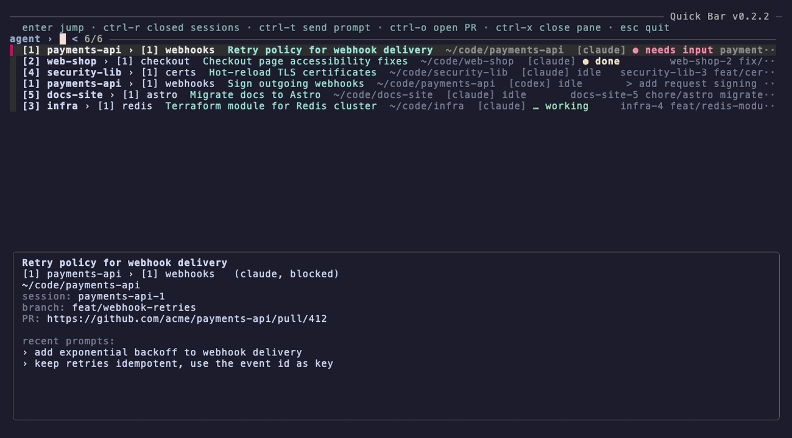

# Quick Bar

A [herdr](https://herdr.dev) plugin that opens a fuzzy-search popup over all running agent sessions and jumps straight to the selected pane.

Lost the terminal where you added a new certificate strategy to the security library? Open Quick Bar, type `security`, hit Enter.

## Quick start

1. **Install fzf** (required, 0.60 or newer): `brew install fzf`, or your Linux package manager.
2. **Install the plugin:**
   ```sh
   herdr plugin install Benny93/herdr-quick-bar
   ```
3. **Bind a key** in `~/.config/herdr/config.toml`, then run `herdr server reload-config`:
   ```toml
   [[keys.command]]
   key = "prefix+f"
   type = "plugin_action"
   command = "benny93.quick-bar.open"
   description = "find agent session"
   ```
4. **Open it:** press your herdr prefix, then `f`. Without a key binding: `herdr plugin action invoke benny93.quick-bar.open`.

Also needs `python3` and herdr 0.9.0 or newer.



<sub>Demo uses mock data (`demo/herdr`). Re-record with `vhs demo/demo.tape`.</sub>

## What it searches

For every agent herdr knows about:

- workspace and tab name, cwd, agent status
- for agents other than Claude Code (Codex, opencode, Copilot, …): the text currently on their screen
- for Claude Code sessions, also: AI-generated session titles (current and earlier), session name, git branches, PR links, and your last 20 prompts

The preview pane shows the session details and highlights the prompts that match your query.

With an empty query, sessions that need you come first: **needs input** (waiting on a question or approval), then **done** (finished, not looked at yet), then idle, then working. Within each group the most recently changed comes first. Once you type, the list is ranked by match quality and this order only breaks ties.

## Usage

| Key | Action |
| --- | --- |
| type | filter (fuzzy; `'word` for exact, space for AND) |
| ↑ / ↓ | move |
| Enter | focus the agent's pane (closed session: resume it in a new tab) |
| Ctrl-R | toggle closed Claude sessions in the list |
| Ctrl-T | type a prompt and send it to the selected agent without jumping |
| Ctrl-O | open the session's latest PR in the browser |
| Ctrl-X | close the selected pane (asks y/N first; stops the agent) |
| Esc | close |

## How it works

`herdr api snapshot` gives the agents, workspaces and tabs in one call. For each Claude pane, the pane's foreground process id (remembered between opens) maps to `~/.claude/sessions/<pid>.json`, which holds the session id; the transcript at `~/.claude/projects/*/<sessionId>.jsonl` supplies titles, prompts, branches and PR links. `CLAUDE_CONFIG_DIR` is respected.

Parsed transcripts are cached in the plugin state dir (`quick-bar-transcripts.json`), keyed by file mtime and size, so only sessions that changed are re-read. Delete the file to rebuild it.

Closed sessions (Ctrl-R) are every transcript under `~/.claude/projects` whose Claude process is no longer running. Enter opens a new tab in that session's folder, in the workspace that already has an agent there (else the current one), and runs `claude --resume <id>`.

## Troubleshooting

**"Quick Bar needs fzf"** although fzf is installed: the bar looks on `PATH` plus the usual install folders (`/opt/homebrew/bin`, `/usr/local/bin`, Linuxbrew, `~/.fzf/bin`, `~/.local/bin`, Nix). That covers herdr running as a service (`brew services`) with a minimal `PATH`. If fzf lives elsewhere, start herdr from a shell where `which fzf` works.

## Development

Link a local clone instead of installing; edits apply the next time the bar opens:

```sh
herdr plugin link /path/to/herdr-quick-bar
```
